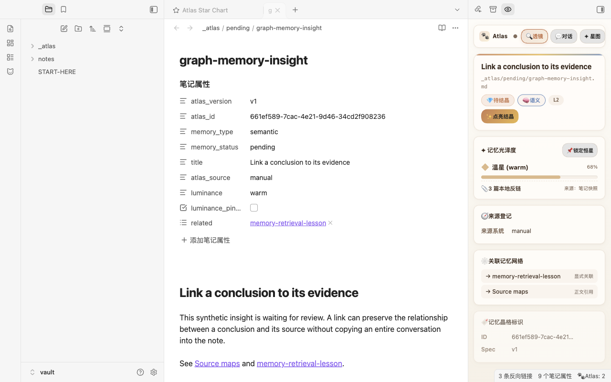
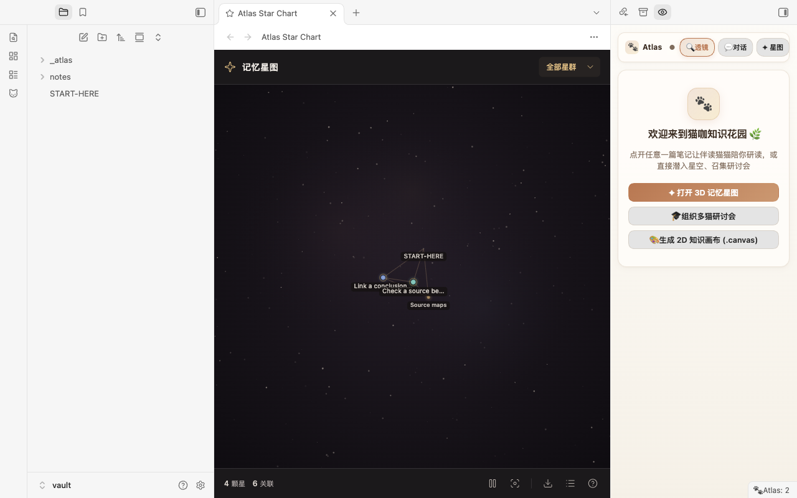

# Clowder Atlas

[简体中文](README.zh-CN.md)

Explore linked notes as a memory star chart, inspect their provenance, and optionally bring Clowder AI companions into your reading workflow.

Clowder Atlas works without an AI service for local exploration and curation. Chat and passage revision require a separately running [Clowder AI](https://github.com/zts212653/clowder-ai) instance. The interface currently uses Chinese labels alongside English command names.

## What it does

- **Memory star chart:** explore all Markdown notes and their local link relationships, with memory type filters and brightness based on incoming links.
- **Provenance Lens:** inspect note metadata, sources, related notes, memory type, and draft/pending/crystallized status.
- **Local curation:** add memory metadata, create templates, review pending insights, and export Atlas notes to a new Obsidian Canvas.
- **Optional companions:** read and discuss notes in a chat sidebar, organize a multi-cat seminar, and save useful replies as pending notes or append them to a note.
- **Selected passages:** select text in the editor and choose **🐾 把选中段落交给猫猫**, or run **Clowder Atlas: Ask Cats About Selection**. Tell the cats whether you want discussion or a rewrite. A reply containing a revision can be compared with the original and applied after confirmation.





## Installation

Clowder Atlas is [listed in the Obsidian Community directory](https://community.obsidian.md/plugins/clowder-atlas). Select **Add to Obsidian** on that page to open the plugin in desktop Obsidian, then install and enable it. Manual installation is also available below.

For manual installation, download the three assets from the same release: `main.js`, `manifest.json`, and `styles.css`. Put them in `<vault>/.obsidian/plugins/clowder-atlas/`, then enable **Clowder Atlas** in **Settings → Community plugins**. Reload the plugin after updating its files.

This release supports **desktop Obsidian 1.14.5 or newer**. Version 1.14.5 is the conservative desktop baseline used for acceptance; earlier versions and mobile have not been certified. Node.js is needed only to build from source, not to use the plugin.

## First use

1. The star chart and Provenance Lens open when the plugin is enabled. Existing Markdown notes can be explored immediately.
2. To curate a note, open it in the Lens and choose **✨ 赋予这篇笔记记忆身份**, or use a memory template command. Changes to metadata are explicit actions.
3. A pending note can be reviewed and crystallized. Notes in `_atlas/pending/` move to `_atlas/crystals/` when crystallized; notes elsewhere stay in their own folders.
4. To use companions, open **💬 对话** and choose **🔌 一键连接猫咖**, or **⚙️ 填写地址**. Clowder AI must already be running. Connection settings and a roster refresh are available inside the chat panel's **⚙**.

The default API address is `http://localhost:3004`. The connection is disabled until you enable it. Local note exploration does not require a Clowder AI account. Companion use depends on that instance's configuration, model accounts, and any provider charges.

## Passage revision

Select a passage in an **editing view**, attach it with the single menu action, and write your request. With a passage attached, the message contains that passage rather than a note preview. Empty requests ask the cats for their thoughts and an optional revision.

Revisions must be returned in a fenced block labelled `修改稿`. Only replies linked to exactly one stored passage request offer **✏️ 替换原段落**. Other revisions can be copied. The comparison dialog checks the original again when you confirm. An open editor replacement is undoable in that editor; closed-file writes do not provide an editor undo step. If you changed the passage or its location is ambiguous, automatic replacement is refused.

Different cats' versions for the same request can be swapped. A later follow-up without an attached passage does not automatically inherit a revision target: select the text again for another editable request.

## Privacy and network use

The plugin has no client-side telemetry and does not download code or runtime dependencies. It reads local note metadata and links for its views; file edits and exports stay within the vault through Obsidian APIs.

When you enable the optional connection, it reads the configured Cat Cafe API for health, cats, threads, and messages, and loads avatar images from that instance's frontend. **One-click connect** probes the configured address and local ports 3004, 3000, 3001, 3005, 4000, and 8080. It does not scan other machines.

Sending chat or a seminar sends your message and any attached material to that instance, which may forward it to its configured AI providers. Ordinary note attachment includes up to 1,000 characters in chat or 1,500 in a seminar; passage attachment includes the selected text, up to 90,000 characters. AI data retention and billing are controlled by that service and its providers.

Failed messages, attachment text, revision targets, and connection preferences are stored unencrypted in the plugin's local `data.json`. Unresolved failed messages have no automatic count or time expiry. That file may also be included in your own vault backups or sync configuration. See [PRIVACY.md](PRIVACY.md) for details.

## Build and test

Use Node.js 22 or newer. There are no npm dependencies and no install step is required.

```sh
npm run build
npm test
```

The handwritten CommonJS source is in `src/main.js`; Obsidian supplies the `obsidian` module. Building copies it and the stylesheet without transformation. The three installable assets are written to the root and to `dist/`. The release must attach the three individual files from `dist/`.

The `demo/` folder contains synthetic notes only. See [PUBLISHING.md](PUBLISHING.md) for release preparation, [RELEASE_NOTES.md](RELEASE_NOTES.md) for the release notes, and [SECURITY.md](SECURITY.md) for reporting concerns.

With Obsidian installed, `npm run test:desktop` launches a fresh disposable profile, installs the files from `dist/`, exercises local curation, and reopens it. Set `OBSIDIAN_BIN` if the executable is not at the usual macOS path. Results and synthetic screenshots are written under `artifacts/desktop/`; your own vault and running profile are not reused.

## License

[MIT](LICENSE). No third-party runtime libraries are bundled; the Obsidian API is provided by the host application. Clowder Atlas is a community project and is not affiliated with or endorsed by Obsidian.
