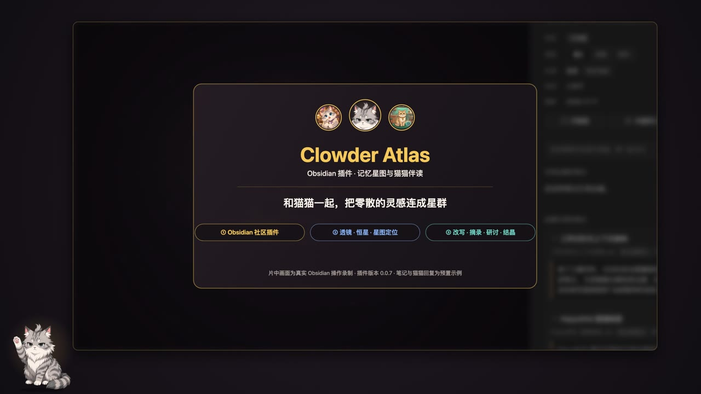

# Clowder Atlas

[简体中文](README.zh-CN.md)

Clowder Atlas helps you trace a note back to its sources and see where it fits in your Obsidian vault. Open the **Provenance Lens** to read the paragraphs behind links, then find the note on an interactive **3D star chart**. Rotate or zoom the chart and click a star to open its note.

[**Watch the 71-second demo**](https://yukinaxser.github.io/clowder-atlas/)

[](https://yukinaxser.github.io/clowder-atlas/)

Recorded in desktop Obsidian with Clowder Atlas 0.0.7. The demo has Chinese narration and uses sample notes and prepared companion replies.

## What you can do

- **Trace a source.** See note properties at the top of the Lens, read incoming and outgoing link excerpts, and jump back to the original text.
- **Collect and review.** Add excerpts from multiple notes to one tray. Use templates to organize notes, review pending insights before keeping them, or export notes to an Obsidian Canvas.
- **Discuss or revise a passage.** Connect a running Clowder AI instance to chat about selections, start a seminar, or save replies as pending notes with source links. Compare a revision for a single passage before choosing to replace it.

The chart, Lens, templates and local review work offline. Chat and passage revision use a separately running [Clowder AI](https://github.com/zts212653/clowder-ai) instance. The interface uses Chinese labels and English command names.

## Installation

Search for **Clowder Atlas** in **Settings → Community plugins → Browse**. Select **Install**, then **Enable**. You can also open the [Obsidian Community listing](https://community.obsidian.md/plugins/clowder-atlas).

For manual installation, download the three assets from the same release: `main.js`, `manifest.json`, and `styles.css`. Put them in `<vault>/.obsidian/plugins/clowder-atlas/`, then enable **Clowder Atlas** in **Settings → Community plugins**. Reload the plugin after updating its files.

This release supports **desktop Obsidian 1.14.5 or newer**. Version 1.14.5 is the conservative desktop baseline used for acceptance; earlier versions and mobile have not been certified. Node.js is needed only to build from source, not to use the plugin.

## First use

1. The star chart and Provenance Lens open when the plugin is enabled. Existing Markdown notes can be explored immediately.
2. To classify a note, choose **语义**, **情景** or **程序** in the Lens properties, or use a memory template command. Opening a note leaves its properties alone.
3. A pending note can be reviewed and crystallized. Notes in `_atlas/pending/` move to `_atlas/crystals/` when crystallized; notes elsewhere stay in their own folders.
4. To use companions, open **对话** and choose **一键连接猫咖**, or **填写地址**. Clowder AI must already be running. Connection settings and a roster refresh are available inside the chat panel's settings (gear) button.

The default API address is `http://localhost:3004`. The connection is disabled until you enable it. Local note exploration does not require a Clowder AI account. Companion use depends on that instance's configuration, model accounts, and any provider charges.

## Cross-file passage research

Select text in a note and choose **把选中段落交给猫猫**, then do the same in other notes. Selections accumulate in a numbered tray; selecting the same text at the same location again does not duplicate it. Click a source chip to return to its note, remove individual selections, or clear the tray. Unsent selections survive plugin reloads and have no automatic expiry. The combined selection limit is 90,000 characters; the final message including your question and source labels must also fit the Cat Cafe limit.

Send a question referring to **#1**, **#2**, etc., or open **研讨会** for comparison, evidence-chain analysis, synthesis, or debate. **+** carries the entire tray into a new conversation. While selections are attached, the whole-note attachment is excluded.

A revision answering a multi-passage request is **copy-only**. A single-passage request retains the comparison and replacement flow below. Saving a matched reply as a pending note links the source notes of that request, with full vault-relative paths to distinguish identical filenames; it does not combine sources from unrelated requests in the same conversation. If the Cat Cafe does not identify the input message a reply answers, the plugin cannot infer those sources. Failed sends retain every selection for retry or restoration.

## Passage revision

Select a passage in an **editing view**, attach it with the single menu action, and write your request. With a passage attached, the message contains that passage rather than a note preview. Empty requests ask the cats for their thoughts and an optional revision.

Revisions must be returned in a fenced block labelled `修改稿`. Only replies linked to exactly one stored passage request offer **替换原段落**. Other revisions can be copied. The comparison dialog checks the original again when you confirm. An open editor replacement is undoable in that editor; closed-file writes do not provide an editor undo step. If you changed the passage or its location is ambiguous, automatic replacement is refused.

Different cats' versions for the same request can be swapped. A later follow-up without an attached passage does not automatically inherit a revision target: select the text again for another editable request.

## Privacy and network use

The plugin has no client-side telemetry and does not download code or runtime dependencies. It reads local note metadata and links for its views; file edits and exports stay within the vault through Obsidian APIs.

When you enable the optional connection, it reads the configured Cat Cafe API for health, cats, threads, and messages, and loads avatar images from that instance's frontend. **One-click connect** probes the configured address and local ports 3004, 3000, 3001, 3005, 4000, and 8080. It does not scan other machines.

Sending chat or a seminar sends your message and any attached material to that instance, which may forward it to its configured AI providers. Ordinary note attachment includes up to 1,000 characters in chat or 1,500 in a seminar; passage attachment includes the selected text, up to 90,000 characters. A seminar in a new conversation first creates that conversation in the instance, under the vault's path, with a temporary title from the attached note, passage lines, or topic. AI data retention and billing are controlled by that service and its providers.

Failed messages, attachment text, revision targets, and connection preferences are stored unencrypted in the plugin's local `data.json`. Unresolved failed messages have no automatic count or time expiry. That file may also be included in your own vault backups or sync configuration. See [PRIVACY.md](PRIVACY.md) for details.

## Build and test

Use Node.js 22 or newer. There are no npm dependencies and no install step is required.

```sh
npm run build
npm test
```

The handwritten CommonJS source is in `src/main.js`; Obsidian supplies the `obsidian` module. Building copies it and the stylesheet without transformation. The three installable assets are written to the root and to `dist/`. The release must attach the three individual files from `dist/`.

The `demo/` folder contains synthetic notes only. See [PUBLISHING.md](PUBLISHING.md) for release preparation, [RELEASE_NOTES.md](RELEASE_NOTES.md) for the release notes, and [SECURITY.md](SECURITY.md) for reporting concerns.

With Obsidian installed, `npm run test:desktop` launches a fresh disposable profile, installs the files from `dist/`, exercises local curation, and reopens it. Set `OBSIDIAN_BIN` if the executable is not at the usual macOS path. Results and synthetic screenshots are written under `artifacts/desktop/`; your own vault and running profile are not reused.

## License

[MIT](LICENSE). No third-party runtime libraries are bundled; the Obsidian API is provided by the host application. Clowder Atlas is a community project and is not affiliated with or endorsed by Obsidian.
